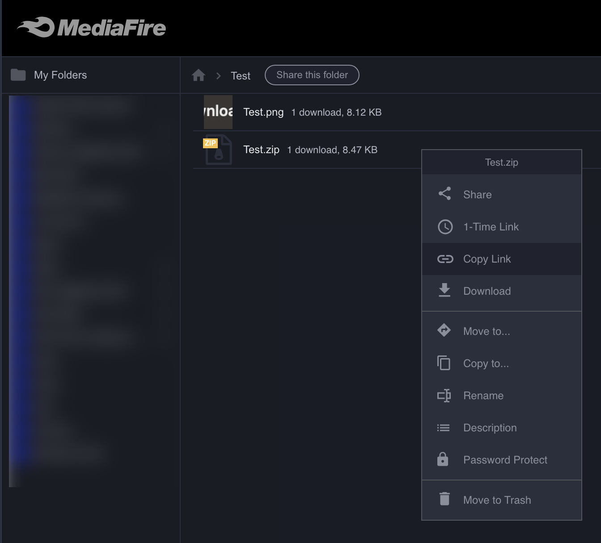
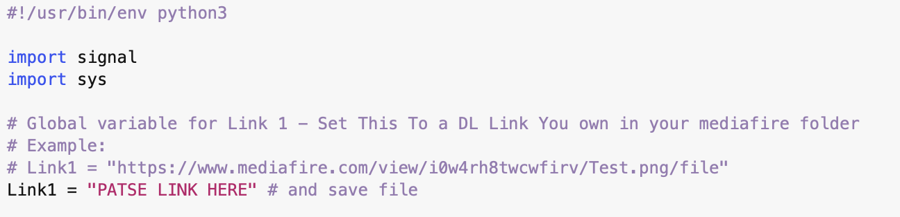

<a id="scripts"></a>

# 🛠️ Scripts

A collection of scripts for save editing and small utilities.

**Browse:** [📋 Script catalogue](#script-catalogue) · [🐍 Python setup](#python-setup) · [🎮 Death Stranding](#death-stranding) · [🔢 pyconvert](#pyconvert) · [🧱 Apollo build](#apollo-lib-compiler-for-macos) · [📥 MediaFire](#mediafire)

## Script catalogue

| Script | What it does | Guide |
| --- | --- | --- |
| [Death Stranding](Death%20Stranding) | Repairs and upgrades structures across the map, excluding safehouses; can also max the resources in owned safehouses. | [Usage guide](Death%20Stranding/README.md) |
| [pyconvert](pyconvert.py) | Converts decimal and hexadecimal values, including floats; run with `--help` to see all options. | Examples below |
| [Apollo-lib Compiler macOS](apollo-lib-macos.md) | Builds Universal2 (`x86_64` + `arm64`) Apollo CLI tools and the desktop GUI, including patch data, font, and code-type icons. | [Build guide](apollo-lib-macos.md) |
| [MediaFire](MediaFire.py) | Combines blocked/dangerous MediaFire links so the file can be copied to your own drive. | Instructions below |

## Python setup

Before running any Python script, run the following setup from the repository root.

macOS/Linux:

```sh
python3 -m venv .venv
source .venv/bin/activate
python -m pip install -r requirements.txt
```

Windows PowerShell:

```powershell
py -m venv .venv
.venv\Scripts\Activate.ps1
python -m pip install -r requirements.txt
```

Reactivate `.venv` in each new shell. All later Python examples assume that it is active and are run from the repository root.

## Death Stranding

See the [Death Stranding guide](Death%20Stranding/README.md) for setup, options, examples, and warnings for both scripts.

## pyconvert

Run from the repository root:

```sh
python Scripts/pyconvert.py 999 -ui32
```

This outputs the hexadecimal value of 999 as a 32-bit integer (4 bytes), using Big Endian by default. Add `--little` to use Little Endian.

```sh
python Scripts/pyconvert.py 0x000003E7 -ui32
```

This outputs the decimal value. Hexadecimal values must start with `0x` when converting back to decimal.

```sh
python Scripts/pyconvert.py C39E943977124BE8 -swp
```

This swaps the endianness of the hexadecimal input.

## Apollo-lib Compiler for macOS

By default, the wrapper keeps source checkouts, disposable build copies, and CLI tools under `$HOME/Desktop/apollo`. An ignored adjacent `.conf` file configures those paths and GUI installation. The wrapper automatically installs missing build tools, builds from source copies, and installs and registers `Apollo Patcher.app` in `/Applications` by default. Full Xcode is optional; Command Line Tools are enough.

See the [Apollo-lib macOS build guide](apollo-lib-macos.md) for configuration, GitHub SSH setup, signing, build lifecycle, and usage.

## MediaFire

You must first be logged in to MediaFire and have a dummy file uploaded to your own MediaFire drive. Use that file to set `Link1`.

Run the script from the repository root:

```sh
python Scripts/MediaFire.py
```

Enter the link you are trying to access. The script returns a combined link, for example `mediafire.com/?i0w4rh8twcwfirv,znig9z0dsbg6x7k`.

<details>
<summary>View the MediaFire steps</summary>

<a href=".images/Step1.png" target="_blank"></a>

<a href=".images/Step2.png" target="_blank"></a>

You should see one of your files and the blocked file. Right-click the blocked file (shown with a red tint), choose **Copy File To**, and select your own drive. You can then download the blocked file from your drive.

</details>
